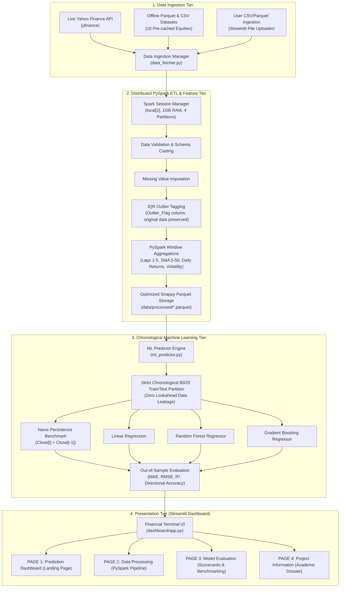
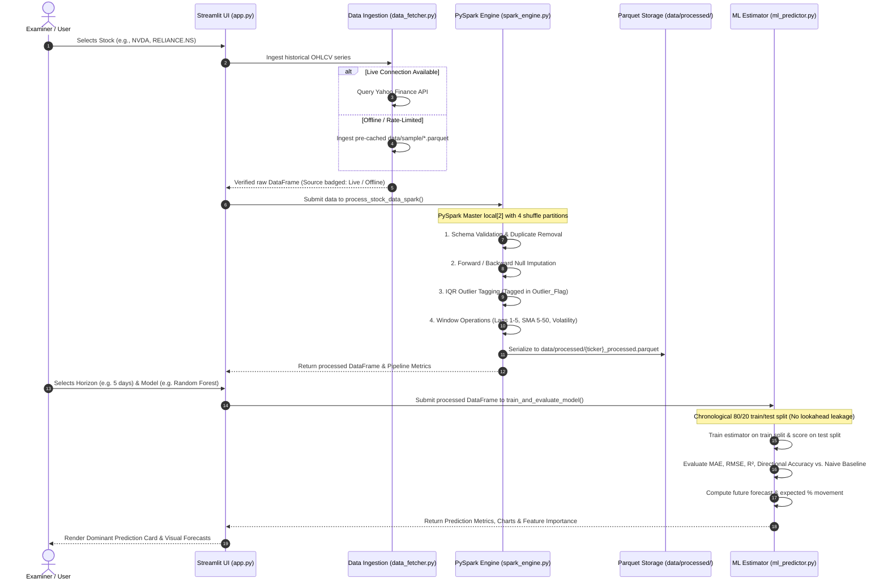

# StockSense: Complete System Blueprints & Application Architecture

This document provides the technical blueprints, data engineering pipelines, mathematical specifications, and UI element catalog for **StockSense – Big Data Analytics in Stock Market Prediction**.

---

## 1. System Architecture Blueprint

StockSense is structured as an end-to-end distributed data engineering and machine learning pipeline specifically engineered for stock market prediction:



---

## 2. End-to-End Execution Sequence



---

## 3. Core Engine Blueprints & Technical Logic

### A. Distributed Big Data Engine (`src/spark_engine.py`)
- **PySpark Session Configuration:**
  - `spark.master`: `local[2]` (Multi-threaded local cluster for developer environments).
  - `spark.driver.memory`: `1g` (Prevents JVM heap starvation on 4GB RAM hardware).
  - `spark.sql.shuffle.partitions`: `4` (Optimized partition latency).
  - `spark.sql.execution.arrow.pyspark.enabled`: `false` (Avoids PyArrow chunk serialization warnings across Python 3.12).
- **PySpark Window Aggregations:**
  ```python
  window_spec_order = Window.partitionBy(F.lit("GLOBAL")).orderBy("Date")
  window_20 = Window.partitionBy(F.lit("GLOBAL")).orderBy("Date").rowsBetween(-19, 0)
  
  # Lag feature
  spark_df = spark_df.withColumn("Lag_1", F.lag(F.col("Close"), 1).over(window_spec_order))
  # 20-Day SMA
  spark_df = spark_df.withColumn("SMA_20", F.avg(F.col("Close")).over(window_20))
  # Rolling volatility
  spark_df = spark_df.withColumn("Volatility_20d", F.stddev(F.col("Daily_Return")).over(window_20))
  ```
- **Outlier Detection via Interquartile Range (IQR):**
  - Identifies returns outside $[Q1 - 1.5 \times IQR, Q3 + 1.5 \times IQR]$.
  - Preserves original price data by tagging anomalies in `Outlier_Flag` rather than silently deleting rows.

---

### B. Machine Learning Engine (`src/ml_predictor.py`)

- **Data Leakage Prevention:**
  - Chronological 80/20 train/test split strictly preserves temporal order:
    $$\text{Train Index} \in [0, 0.8N), \quad \text{Test Index} \in [0.8N, N]$$
- **Naive Persistence Baseline:**
  - In financial econometrics, models must beat the previous-day price ($Close_t = Close_{t-1}$):
    $$\hat{y}_t^{\text{naive}} = y_{t-1}$$
- **Directional Accuracy Formulation:**
  $$\text{Directional Accuracy} = \frac{1}{M} \sum_{i=1}^M \mathbf{1}_{\left(\text{sign}(y_i - y_{i-1}) == \text{sign}(\hat{y}_i - y_{i-1})\right)} \times 100\%$$

---

## 4. Complete Catalog of Application Elements (4 Pages)

### Page 1: Prediction Dashboard (Primary Landing Page)
| Element | Type | Purpose & Details |
| :--- | :--- | :--- |
| **Top Executive Banner** | HTML/CSS Header | Project title, Spark 3.5 status indicator, active market feed badge. |
| **Stock & Currency Display** | KPI Cards | Active stock symbol, country/exchange identification, latest closing price and day delta with date. |
| **Historical Price Action Chart** | Interactive Plotly Area Chart | Historical closing prices overlaid with PySpark-generated 20-day and 50-day moving averages. |
| **Prediction Controls** | Sliders & Dropdown | Prediction horizon slider (1, 5, 10, 15, 30 days) and model dropdown (LR, RF, GBDT). |
| **Dominant Prediction Card** | High-Contrast Gradient Card | Large future price forecast, expected delta ($ and %), and test set reliability metrics (MAE, RMSE, Dir. Acc.). |
| **Out-of-Sample Test Chart** | Multi-Line Plotly Chart | Ground truth actual prices vs. selected model predictions and the naive baseline over the test period. |
| **Prediction Summary Box** | Information Box | Academic interpretation, error bounds, and top contributing engineered features bar chart. |

### Page 2: Data Processing
| Element | Type | Purpose & Details |
| :--- | :--- | :--- |
| **5-Stage Visual Workflow** | Stepper Diagram | Visualizes Ingestion $\to$ Validation $\to$ IQR Outliers $\to$ Spark Window $\to$ Parquet Storage. |
| **Execution Trigger** | Button | Triggers live PySpark distributed transformation job. |
| **Telemetry KPI Banner** | 4 Stat Cards | Input records, output records, duplicates/missing handled, outliers flagged, execution time. |
| **Engine Badge** | Verified Status Badge | Transparently states `Apache PySpark (Distributed Local)` or `Pandas Fallback`. |
| **Outlier Treatment Box** | Alert Card | Documents IQR detection protocol preserving genuine historical price action. |
| **Engineered Features List** | Tag Cloud | Displays all 11 generated features (`Lag_1` to `Lag_5`, `SMA_5` to `SMA_50`, `Volatility_20d`, `Outlier_Flag`). |
| **Before & After Previews** | Tabbed DataFrames | Side-by-side inspection of raw input vs. feature-rich Parquet dataset. |

### Page 3: Model Evaluation
| Element | Type | Purpose & Details |
| :--- | :--- | :--- |
| **Horizon Selector** | Slider | Adjusts evaluation horizon for side-by-side benchmarking. |
| **Top Performer Showcase** | Highlight Card | Identifies top model based on out-of-sample test MAE (not training performance) and comparison with baseline. |
| **Comparative Scorecard** | Data Table | Full metrics (MAE, RMSE, $R^2$, Directional Accuracy %, Forecast Price, Expected Move) across all models. |
| **Multi-Model Overlay Chart** | Interactive Plotly Chart | Overlays Actual Close, Linear Regression, Random Forest, Gradient Boosting, and Naive Baseline on the test set. |
| **Methodology Cards** | Two-Column Information | Explains chronological splitting and the econometrics behind the persistence baseline. |

### Page 4: Project Information
| Element | Type | Purpose & Details |
| :--- | :--- | :--- |
| **Problem & Solution** | Two Cards | Financial non-stationarity, RAM limitations of Pandas, and distributed PySpark architecture. |
| **5Vs of Big Data** | 5 Grid Cards | Volume, Velocity, Variety, Veracity, and Value applied to stock market prediction. |
| **Architecture Flowchart** | Text / ASCII Diagram | End-to-end data flow from Yahoo Finance to PySpark ETL, Parquet storage, ML modeling, and Streamlit. |
| **Roles of Spark & ML** | Two Cards | Catalyst query optimizer, distributed windowing, out-of-core scaling, and nonlinear regression. |
| **Limitations & Scope** | Two Cards | Exogenous macroeconomic events, local multi-threaded mode, Kafka streaming, and FinBERT NLP future scope. |
