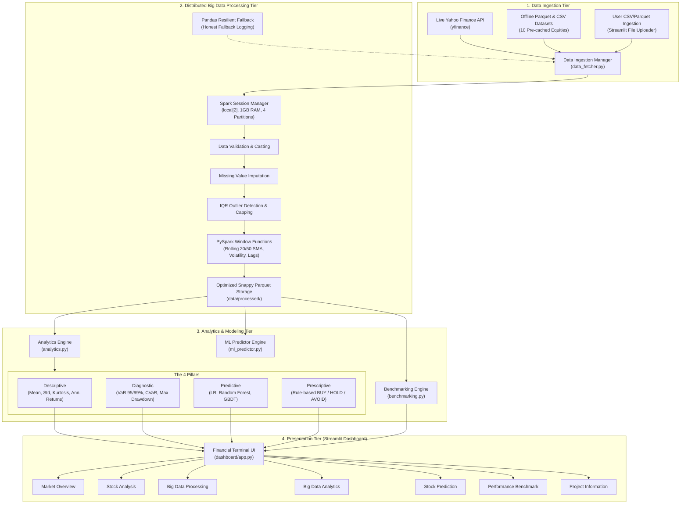
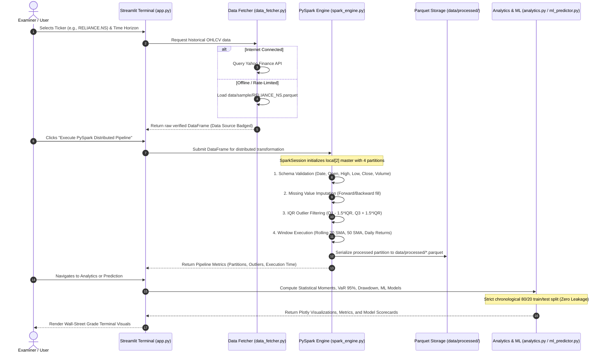
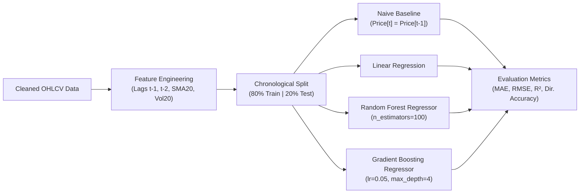

# StockSense: Complete System Blueprints & Application Architecture

This document provides the technical blueprints, data engineering pipelines, mathematical specifications, and UI element catalog for **StockSense – Big Data Analytics in Stock Market Prediction**.

---

## 1. System Architecture Blueprint

StockSense is structured as a multi-tier, decoupled architecture designed for high-throughput financial data processing, distributed transformation, and responsive client presentation.



---

## 2. End-to-End Execution Sequence

This sequence diagram illustrates how data flows when an end user or examiner interacts with the platform:



---

## 3. Core Engine Blueprints & Technical Logic

### A. Distributed Big Data Engine (`src/spark_engine.py`)
- **Spark Session Configuration:**
  - `spark.master`: `local[2]` (Multi-threaded local cluster for developer environments).
  - `spark.driver.memory`: `1g` (Prevents JVM heap starvation).
  - `spark.sql.shuffle.partitions`: `4` (Optimized for low partition latency without distributed shuffle overhead).
  - `spark.sql.execution.arrow.pyspark.enabled`: `false` (Avoids PyArrow chunk serialization warnings across Python 3.12).
- **Window Specification:**
  ```python
  window_spec = Window.partitionBy(F.lit("GLOBAL")).orderBy("Date")
  # Calculates rolling 20-day mean without cross-partition shuffling
  df = df.withColumn("SMA_20", F.avg("Close").over(window_spec.rowsBetween(-19, 0)))
  ```
- **Outlier Detection via Interquartile Range (IQR):**
  - Identifies returns outside $[Q1 - 1.5 \times IQR, Q3 + 1.5 \times IQR]$.
  - Flags and caps extreme artificial spikes to protect downstream machine learning estimators.
- **Honest Engine Auditing:**
  - If Java or PySpark is missing, the engine executes through an identical Pandas pipeline but explicitly flags `engine_used = "Pandas (Fallback Engine)"` to maintain academic transparency.

---

### B. Financial Analytics Mathematical Specifications (`src/analytics.py`)

#### 1. Historical Value-at-Risk (VaR)
Measures the maximum expected financial loss at a given $(1 - \alpha)$ confidence level:
$$\text{VaR}_{\alpha} = \text{Percentile}(R, \alpha \times 100)$$
- **95% 1-Day VaR:** 5th percentile of historical daily return series $R$.
- **99% 1-Day VaR:** 1st percentile of historical daily return series $R$.

#### 2. Conditional Value-at-Risk (CVaR / Expected Shortfall)
The expected loss given that the loss exceeds the VaR threshold:
$$\text{CVaR}_{\alpha} = \mathbb{E}[R \mid R \le \text{VaR}_{\alpha}]$$

#### 3. Maximum Underwater Drawdown
Measures the peak-to-trough decline of cumulative portfolio equity:
$$\text{Cumulative Peak}_t = \max_{\tau \le t}(\text{Close}_\tau)$$
$$\text{Drawdown}_t = \frac{\text{Close}_t - \text{Cumulative Peak}_t}{\text{Cumulative Peak}_t}$$
$$\text{Max Drawdown} = \min_{t}(\text{Drawdown}_t)$$

#### 4. Prescriptive Action Matrix
The engine combines three quantitative signals into a deterministic action score:
1. **Momentum (RSI-14):** Overbought ($> 70$), Oversold ($< 30$), Neutral ($30 - 70$).
2. **Trend Alignment:** Price relative to the 50-day Simple Moving Average ($Close > SMA_{50} \implies$ Bullish).
3. **Volatility Regime:** Daily return standard deviation compared against historical quartiles.
- **BUY:** Oversold ($RSI < 35$) with upward trend recovery or $Close > SMA_{50}$ with low drawdown.
- **HOLD:** Neutral range ($40 \le RSI \le 60$) with stable volatility.
- **AVOID / TAKE PROFIT:** Extreme overbought ($RSI > 75$) or deep downward momentum below $SMA_{50}$.

---

### C. Machine Learning Engine (`src/ml_predictor.py`)



- **Data Leakage Prevention:**
  - Traditional $k$-fold cross-validation randomly shuffles observations, leaking future price information into past models.
  - StockSense uses strict **chronological train/test splitting** (first 80% dates for training, final 20% for out-of-sample evaluation).
- **Naive Baseline Comparison:**
  - Evaluates models against $y_{t} = y_{t-1}$. In financial econometrics, a model that cannot outperform yesterday's price is not statistically predictive.
- **Directional Accuracy:**
  $$\text{Directional Accuracy} = \frac{1}{N} \sum_{t=1}^N \mathbf{1}_{(\text{sign}(y_t - y_{t-1}) == \text{sign}(\hat{y}_t - y_{t-1}))}$$

---

## 4. Complete Catalog of Application Elements

The Streamlit dashboard (`dashboard/app.py`) is structured into 7 distinct presentation pages:

### Page 1: Market Overview
| UI Element | Component Type | Functionality & Source |
| :--- | :--- | :--- |
| **Executive Header** | Dark Glassmorphic Card | Displays project title, active market mode, and system status indicator. |
| **Ticker Tape** | Horizontal Metric Bar | Shows live closing prices and daily % delta for NVDA, AAPL, MSFT, RELIANCE, TCS. |
| **52-Week Range Bar** | Custom HTML/CSS Progress Gauge | Visual indicator showing where current price sits between the 52-week Low and 52-week High. |
| **Key Stats Grid** | 4 High-Contrast KPI Cards | Current Price, Day Change ($ and %), Trading Volume, and 52-Week High/Low. |
| **Top Gainers / Losers** | Dataframe Leaderboard | Highlights the strongest and weakest performers across the monitored watchlist. |
| **Mini-Trend Chart** | Interactive Plotly Area Chart | Historical daily closing price with fill-to-zero gradient and hover crosshairs. |

### Page 2: Stock Analysis
| UI Element | Component Type | Functionality & Source |
| :--- | :--- | :--- |
| **Date Range Filter** | Streamlit Date Slider / Pickers | Restricts analytical window (1M, 3M, 6M, 1Y, 5Y, All). |
| **Triple Subplot Chart** | 3-Row Plotly Subplot | Row 1: Candlestick + 20 SMA + 50 SMA. Row 2: Color-coded Volume Bars. Row 3: RSI (14) with 70/30 dashed overbought/oversold boundaries. |
| **Return Distribution** | Plotly Histogram & KDE curve | Visualizes the distribution of daily returns against a normal distribution curve. |
| **Cross-Asset Correlation** | Plotly Color Heatmap | Computes Pearson correlation coefficients across all 5 benchmark stocks. |

### Page 3: Big Data Processing
| UI Element | Component Type | Functionality & Source |
| :--- | :--- | :--- |
| **Pipeline Visual Stepper** | 5-Stage Step Diagram | Shows progress: Raw Data $\to$ Validation $\to$ Cleaning $\to$ PySpark Processing $\to$ Parquet Sink. |
| **Execution Trigger** | High-Visibility Action Button | Initiates the distributed PySpark transformation job. |
| **Pipeline Metrics Banner** | 4-Column Stat Cards | Total Records, Outliers Filtered, Execution Time (seconds), Spark Partitions (4). |
| **Engine Badge** | Verified Status Badge | Explicitly displays `Apache PySpark (Distributed Local)` or `Pandas (Fallback Engine)`. |
| **Data & Schema Diff** | Interactive Table View | Before-and-after schema comparison showing newly generated columns (`SMA_20`, `Daily_Return`, `Volatility`). |

### Page 4: Big Data Analytics (The Four Pillars)
| UI Element | Component Type | Functionality & Source |
| :--- | :--- | :--- |
| **Descriptive Tab** | Metric Cards & Moments Table | Mean, Median, Standard Deviation, Skewness, Kurtosis, Annualized Return. |
| **Diagnostic Tab** | Dual-Metric Gauges & Plotly Chart | VaR (95%), VaR (99%), Expected Shortfall (CVaR), and Underwater Drawdown curve. |
| **Predictive Tab** | Model Summary Card | Summary of machine learning directional expectations over 1-day, 5-day, and 10-day horizons. |
| **Prescriptive Tab** | Wall-Street Action Card | Action Posture (BUY / HOLD / AVOID), Risk Rating (Low / Moderate / High), and 4 Quantitative Bullet Rationales. |
| **Compliance Disclaimer** | Warning Callout Box | Explicitly states that signals are algorithmic and educational, not financial advice. |

### Page 5: Stock Prediction
| UI Element | Component Type | Functionality & Source |
| :--- | :--- | :--- |
| **Model Config Panel** | Sidebar Controls | Model selection (Linear Regression, Random Forest, GBDT) and Horizon (1 to 30 days). |
| **Actual vs. Predicted Chart** | Overlay Line Chart | Shows out-of-sample test set actual prices versus model forecasts and Naive baseline. |
| **Evaluation Metrics Table** | Comparative Grid | MAE, RMSE, $R^2$, and Directional Accuracy (%) for all models side-by-side. |
| **Forecast Badge** | Highlight Stat Card | Estimated future price with calculated % expected move. |

### Page 6: Performance Benchmark
| UI Element | Component Type | Functionality & Source |
| :--- | :--- | :--- |
| **Scale Slider** | Interactive Slider | Adjusts synthetic dataset size (1,000, 10,000, 50,000, 100,000 rows). |
| **Benchmark Runner** | Execution Button | Runs live wall-clock timed tests of GroupBy, Windowing, and Filtering in Pandas vs. PySpark. |
| **Latency Comparison Chart** | Grouped Bar Chart | Millisecond latency comparing Pandas vs. PySpark across each analytical operation. |
| **Academic Takeaway Card** | Informational Alert Box | Explains JVM initialization overhead on small data versus horizontal scalability on big data. |

### Page 7: Project Information
| UI Element | Component Type | Functionality & Source |
| :--- | :--- | :--- |
| **5Vs of Big Data** | 5 Grid Metric Cards | Volume, Velocity, Variety, Veracity, and Value contextualized for stock market data. |
| **System Architecture Diagram** | Architectural Flowchart | Ingestion $\to$ PySpark ETL $\to$ Parquet Storage $\to$ Analytics $\to$ Dashboard. |
| **Academic Limitations & Scope**| Two-Column Review | Discusses market volatility limits, sentiment integration, and multi-node cluster deployment. |

---

## 5. Directory Layout Reference

```
stock-analysis-dashboard/
├── dashboard/
│   └── app.py                # Main Streamlit Financial Terminal (7 Pages)
├── src/
│   ├── spark_engine.py       # Distributed PySpark ETL & Outlier Processing
│   ├── data_fetcher.py       # Live Yahoo Finance + Offline Parquet Ingestion
│   ├── analytics.py          # Descriptive, Diagnostic, and Prescriptive Engines
│   ├── ml_predictor.py       # Chronological ML Estimators & Naive Baseline
│   └── benchmarking.py       # Empirical Pandas vs PySpark Benchmark Suite
├── data/
│   ├── sample/               # 10 Pre-cached Offline Equities (.parquet & .csv)
│   ├── processed/            # Parquet Output from Spark Pipelines
│   └── uploaded/             # Temporary store for user uploads
├── scripts/
│   └── generate_sample_data.py # Resilient offline data generator
├── tests/
│   └── test_full_app.py      # Automated 6-stage end-to-end test suite
├── .streamlit/
│   └── config.toml           # Terminal dark theme configuration
├── PRESENTATION_GUIDE.md     # 5-Mark ABL Viva pitch & examiner Q&A
├── BLUEPRINTS.md             # Complete system blueprints & element catalog
└── requirements.txt          # Python dependencies (PySpark, Scikit-Learn, Streamlit)
```
