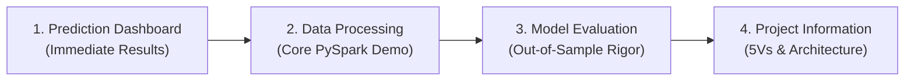

# StockSense: 5-Mark ABL Presentation & Demonstration Guide

> **Project Title:** StockSense – Big Data Analytics in Stock Market Prediction  
> **Repository:** [dinakargowdan585/StockSense-Big-Data-Analytics](https://github.com/dinakargowdan585/StockSense-Big-Data-Analytics)  
> **Local Demo URL:** `http://localhost:8501`  
> **Tech Stack:** Python 3.12, Apache PySpark 3.5, Apache Parquet, Scikit-Learn, Streamlit, Plotly

---

## 1. The 60-Second Opening Pitch (Say This First)

> *"Good morning / afternoon professors. Today I present **StockSense**, a Big Data analytics and machine learning application engineered specifically for **Stock Market Prediction**.*
> 
> *In financial markets, millions of transactions generate high volume and velocity. Standard tools like Pandas crash when datasets exceed RAM and lack distributed windowing capabilities. In StockSense, we engineered an end-to-end distributed Big Data pipeline using **Apache PySpark 3.5** to clean, validate, and extract technical and lagged features from both US (NVDA, AAPL, MSFT) and Indian National Stock Exchange (RELIANCE.NS, TCS.NS) equities.*
> 
> *The processed data is serialized to **Apache Parquet** columnar storage and fed directly into chronologically partitioned machine learning models — Linear Regression, Random Forest, and Gradient Boosting. We evaluate every model against a **Naive Persistence Baseline** on out-of-sample data with zero lookahead leakage."*

---

## 2. 4-Step Interactive Live Demonstration Walkthrough

Follow this 4-step sequence across the 4 pages of the application:

### Step 1: Prediction Dashboard (The Results Hook)
- **Action:** Open `http://localhost:8501`. Show the **Prediction Dashboard**.
- **What to say:**
  - *"This is our primary landing page. It immediately shows what stock is selected and what the model predicts."*
  - Select **NVIDIA (NVDA)** or **Reliance (RELIANCE.NS)** from the sidebar.
  - Point out the **Latest Closing Price** and the transparent **Data Source Badge** (Live API vs. Offline Parquet).
  - Adjust the **Prediction Horizon** (e.g. 5 days) and Model (e.g. Random Forest).
  - Point to the **Dominant Prediction Card**: *"The model predicts a future price of $174.45 (+19.50% expected movement), with an out-of-sample test MAE of ±$11.25."*
  - Show the **Actual vs. Predicted Historical Chart** on the test set, demonstrating how the model tracks market movements.

### Step 2: Data Processing (The PySpark Showcase)
- **Action:** Click **"Data Processing"** in the sidebar.
- **What to say:**
  - *"This is the Big Data processing layer. Click **Execute PySpark Pipeline**."*
  - Walk through the 5-step stepper: Ingestion $\to$ Schema Validation $\to$ Missing-Value Imputation $\to$ IQR Outlier Detection $\to$ Spark Window Aggregations $\to$ Snappy Parquet Storage.
  - Show the telemetry: **Records Processed**, **Partitions (4)**, **Outliers Flagged**, and **Processing Duration**.
  - **Key Academic Point:** *"We do not silently delete genuine extreme market days. Outliers are detected via IQR and annotated in the `Outlier_Flag` column, preserving historical price truth."*
  - Show the **11 Engineered Features** produced by PySpark window functions (`Lag_1` to `Lag_5`, `SMA_5` to `SMA_50`, `Volatility_20d`).

### Step 3: Model Evaluation (Scientific Rigor)
- **Action:** Click **"Model Evaluation"** in the sidebar.
- **What to say:**
  - *"This page provides a rigorous evaluation of all prediction models on the out-of-sample test set."*
  - **Key Academic Point:** *"We enforce a strict **chronological 80/20 train/test split**. In financial time-series, random shuffling causes lookahead data leakage where the model cheats using future information. Our split strictly preserves temporal order."*
  - Show the **Comparative Scorecard**: Linear Regression, Random Forest, Gradient Boosting, and the Naive Baseline ($Close_t = Close_{t-1}$).
  - Point to the **Top Performer Card**: *"The top model is selected strictly based on out-of-sample test MAE, never training performance."*
  - Show the **Multi-Model Overlay Chart** comparing predictions against ground truth actuals.

### Step 4: Project Information (Academic Dossier)
- **Action:** Click **"Project Information"** in the sidebar.
- **What to say:**
  - *"Here we document the academic foundation: the Problem Statement, System Architecture, and the 5Vs of Big Data."*
  - Conclude with the **Role of Apache Spark** (Catalyst optimizer, distributed window operations, out-of-core scalability) and the **Role of Machine Learning**.

---

## 3. High-Scoring Viva Answers to Likely Questions

### Q1: "Why did you use PySpark instead of standard Pandas?"
> **Answer:** *"Pandas is an in-memory, single-threaded library. When historical financial datasets scale into millions of records or tick-level order books, Pandas triggers `OutOfMemoryError`. Apache PySpark executes distributed computations across partitioned DataFrames with Catalyst query optimization, scaling computation seamlessly beyond single-node RAM."*

### Q2: "How did you prevent data leakage in your ML pipeline?"
> **Answer:** *"Traditional cross-validation randomly shuffles observations, which leaks future price information into past training periods. In StockSense, we strictly split data chronologically: the first 80% of dates are used for training, and the final 20% are held out for out-of-sample testing. Lagged and moving average features are strictly backward-looking."*

### Q3: "What is the Naive Persistence Baseline and why is it important?"
> **Answer:** *"The persistence baseline predicts tomorrow's price will equal today's closing price ($Close_t = Close_{t-1}$). Under Eugene Fama's Efficient Market Hypothesis, asset prices follow a near-martingale process. In academic financial ML, if a model cannot beat yesterday's closing price in Mean Absolute Error or Directional Accuracy, it offers no real predictive edge."*

### Q4: "How does the system treat outliers during PySpark processing?"
> **Answer:** *"We use the Interquartile Range (IQR) method on daily returns: $[Q1 - 1.5 \times IQR, Q3 + 1.5 \times IQR]$. Crucially, rather than silently deleting genuine extreme market days (such as market crashes or earnings gaps), our pipeline flags anomalies in an `Outlier_Flag` column while preserving the historical price series intact."*

### Q5: "What is Apache Parquet and why is it used?"
> **Answer:** *"Apache Parquet is an open-source columnar storage format with Snappy compression. Unlike row-oriented CSVs, Parquet supports column projection and predicate pushdown, allowing Spark and downstream ML models to read only the required columns with 70–80% smaller disk footprint and significantly faster I/O."*
