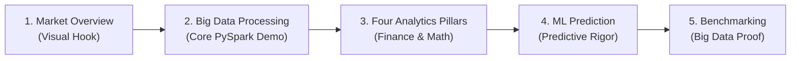

# StockSense: 5-Mark ABL Presentation & Demonstration Guide

> **Project Title:** StockSense – Big Data Analytics in Stock Market Prediction  
> **Repository:** [dinakargowdan585/StockSense-Big-Data-Analytics](https://github.com/dinakargowdan585/StockSense-Big-Data-Analytics)  
> **Local Demo URL:** `http://localhost:8501`  
> **Tech Stack:** Python 3.12, Apache PySpark 3.5, Apache Parquet, Scikit-Learn, Streamlit, Plotly, Pandas

---

## 1. The 60-Second Elevator Pitch (Memorize This)

> *"Good morning / afternoon professors. Today I present **StockSense**, an enterprise-grade Big Data analytics and machine learning platform tailored for equity markets.*
> 
> *In financial markets, millions of transactions generate massive volume and velocity. Standard tools like Pandas crash when data exceeds single-node RAM. In StockSense, we engineered an end-to-end distributed Big Data pipeline using **Apache PySpark 3.5** to clean, validate, and transform high-frequency historical stock data from both US and Indian markets (NSE).*
> 
> *We implemented the **Four Pillars of Financial Analytics** — Descriptive, Diagnostic (including Value at Risk and Maximum Drawdown), Predictive (using chronologically partitioned machine learning), and Prescriptive analytics. Furthermore, we conducted an empirical benchmark comparing Pandas versus PySpark to demonstrate distributed computing scaling trade-offs."*

---

## 2. Interactive Demonstration Walkthrough (Step-by-Step)

Follow this exact 5-step order during your presentation for maximum impact:

### Step 1: Market Overview (The Visual Hook)
- **What to show:** Open `http://localhost:8501`. Show the dark institutional terminal interface.
- **What to say:**
  - *"Notice the top ticker tape and the 52-week range progress bar. We support dual-market tickers: global tech leaders (NVDA, AAPL, MSFT) and Indian blue-chips (RELIANCE.NS, TCS.NS)."*
  - Point out that data source is explicitly badged as **Live Yahoo Finance** or **Cached / Sample Dataset** to guarantee transparency.

### Step 2: Big Data Processing Pipeline (The Core PySpark Showcase)
- **What to show:** Click **"Big Data Processing"** in the sidebar. Click **"Execute PySpark Distributed Pipeline"**.
- **What to say:**
  - *"This is our distributed ETL pipeline. We ingest raw JSON/CSV records, run validation checks, handle missing values, and execute PySpark window functions to calculate 20-day moving averages, daily returns, and log returns across distributed partitions."*
  - Point out the metrics: **Partitions (4)**, **IQR Outliers Filtered**, **Execution Time**, and **Parquet Serialization**.
  - Show the **Schema Evolution & Data Previews** (Before vs After).
  - Highlight the badge: *"Our system honestly detects and displays whether PySpark or Pandas fallback was used — ensuring complete academic integrity."*

### Step 3: Big Data Analytics (The Four Pillars)
- **What to show:** Click **"Big Data Analytics"** in the sidebar.
- **What to say:**
  - **Descriptive Analytics:** *"We calculate statistical moments — mean, volatility, kurtosis, and annual returns."*
  - **Diagnostic Analytics:** *"We compute **Value-at-Risk (VaR at 95% and 99%)**, **Conditional VaR (Expected Shortfall)**, and **Maximum Underwater Drawdown** to measure peak-to-trough risk."*
  - **Prescriptive Analytics:** *"Based on quantitative thresholds (RSI-14 momentum + 50-day moving average distance + volatility risk), the system classifies actionable postures: BUY, HOLD, or AVOID with educational rationales."*

### Step 4: Machine Learning Prediction (Academic Rigor)
- **What to show:** Click **"Stock Prediction"** in the sidebar.
- **What to say:**
  - *"We evaluated three models: **Linear Regression**, **Random Forest**, and **Gradient Boosting**."*
  - **Key Academic Point:** *"Critically, we enforce **strict chronological train/test splitting (80/20)**. Financial time-series cannot be randomly shuffled because random splits cause lookahead bias and data leakage."*
  - Point out the **Naive Persistence Baseline ($Price_{t-1}$)**: *"We compare every model against a persistence baseline. If an ML model cannot beat yesterday's closing price in MAE or Directional Accuracy, it offers no real edge."*

### Step 5: Pandas vs. PySpark Performance Benchmark (The Big Data Definer)
- **What to show:** Click **"Performance Benchmark"** in the sidebar. Run the live benchmark.
- **What to say:**
  - *"Here we test GroupBy aggregations, Rolling Windows, and Filtering on scaled datasets."*
  - **Examiner Anticipation:** Explain why Pandas is faster on smaller datasets: *"On datasets under 50,000 rows, Pandas is faster because PySpark has JVM startup overhead, task serialization, and partition coordination. However, as datasets scale into millions of records, Pandas triggers Out-Of-Memory (OOM) errors, whereas PySpark scales horizontally across clusters."*

---

## 3. High-Scoring Answers to Likely Examiner Questions

### Q1: "Why did you use PySpark instead of standard Pandas?"
> **Answer:** *"Pandas is an in-memory, single-threaded library limited by single-machine RAM. When processing multi-gigabyte or streaming tick-by-tick market feeds, Pandas throws `MemoryError`. PySpark distributes data across an RDD/DataFrame partition graph, utilizing lazy evaluation and Catalyst query optimization to process datasets that exceed single-machine memory."*

### Q2: "What is Value at Risk (VaR) and how did you compute it?"
> **Answer:** *"Historical Value at Risk measures the maximum expected financial loss at a given confidence interval over a specific time horizon. At 95% confidence, it represents the 5th percentile of daily returns. If the 95% VaR is -2.4%, it means there is only a 5% chance the stock will experience a single-day loss worse than 2.4%."*

### Q3: "How did you prevent data leakage in your ML pipeline?"
> **Answer:** *"Standard cross-validation randomly shuffles rows, which leaks future information into past predictions. In StockSense, we strictly split chronologically: the first 80% of chronological dates are used for training, and the subsequent 20% are held out for testing. Feature scalers and lag features ($t-1$, $t-2$) are fit solely on the training partition."*

### Q4: "What is Apache Parquet and why did you choose it over CSV?"
> **Answer:** *"Parquet is an open-source columnar storage format with Snappy compression. Unlike row-oriented CSVs, Parquet enables column projection and predicate pushdown, reading only the queried columns from disk. It reduces storage footprints by 70–80% and accelerates Spark analytics queries up to 10x."*

### Q5: "How does your system handle live market vs offline data?"
> **Answer:** *"We built a resilient two-tier data layer: it attempts real-time ingestion from Yahoo Finance API for both US and NSE stocks. If the machine is offline or rate-limited during the presentation, it seamlessly falls back to pre-generated Parquet/CSV sample datasets without crashing or throwing HTTP errors."*

---

## 4. Key Terminology Cheat Sheet

| Term | Simple Definition | Where It Appears in StockSense |
| :--- | :--- | :--- |
| **5Vs of Big Data** | Volume, Velocity, Variety, Veracity, Value | Project Information Page |
| **Catalyst Optimizer** | PySpark's internal engine that optimizes query execution trees | Big Data Processing |
| **RSI (14)** | Relative Strength Index (0–100); >70 Overbought, <30 Oversold | Stock Analysis Chart |
| **Underwater Chart** | Chart displaying distance from all-time highs to current price | Diagnostic Analytics |
| **Directional Accuracy** | % of trading days where the model correctly guessed Up vs Down | ML Prediction Metrics |
| **Snappy Parquet** | High-speed columnar compression for big data storage | Processing & Data Storage |
